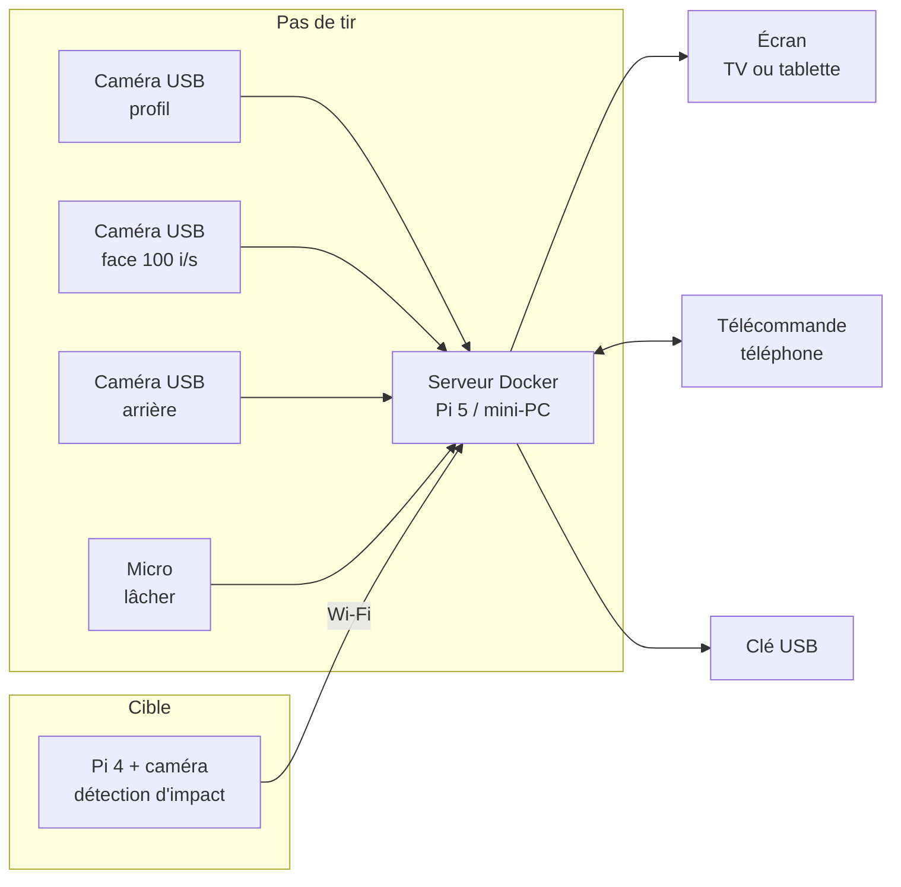

# Arc Replay

Retour vidéo différé multi-caméras pour le tir à l'arc.

L'archer tire, puis voit son geste sur un écran **avec quelques secondes de retard** (10 s par défaut), sous plusieurs angles à la fois. Chaque flèche est découpée en clips que l'on peut rejouer au ralenti ou comparer depuis une télécommande (téléphone ou tablette). Le serveur ne garde que la volée en cours : l'archer qui veut ses vidéos branche sa clé USB, et chaque volée y part automatiquement. Une caméra placée dans le coffre de la cible peut localiser l'impact et calculer le score.

En déplacement, le **[mode solo](docs/mode-solo.md)** fait le retour vidéo différé avec la seule caméra d'une tablette ou d'un PC, sans serveur : https://bathmann-pilax.github.io/Arc-Replay/



## Fonctionnalités

- **Mosaïque en différé** : 1 à 9 vues synchronisées, retard réglable de 3 à 30 s.
- **Ajout de caméras sans code** : une entrée dans `config/arc-replay.yml` (USB, nœud Raspberry Pi ou caméra IP).
- **Gaucher / droitier** : pas d'image inversée, l'écran se déplace sur un support à roulettes pour rester du côté de l'archer ; la latéralité est notée avec chaque flèche.
- **Une flèche = un dossier de clips** : détection du lâcher au micro, ou bouton « marquer ».
- **Rejeu** des flèches de la volée, toutes vues ensemble, en vitesse réelle, ×0,5 ou ×0,25.
- **Comparaison** de deux flèches côte à côte ou superposées, alignées sur le lâcher.
- **Score** détecté par la caméra cible ou saisi sur la télécommande, avec le groupement (centre et dispersion) de la volée et de la séance.
- **Annulation** d'un faux lâcher (tir du voisin capté par le micro).
- **Écran et télécommande séparés** : la TV affiche, le téléphone pilote (QR code à l'écran pour se connecter).
- **Sauvegarde sur la clé de l'archer**, volée par volée : un dossier par flèche, un fichier par caméra, récapitulatifs CSV. Sans clé, rien n'est conservé ; le serveur est vidé en fin de séance et au démarrage.
- **Caméra cible** (prototype) : position de l'impact en millimètres et score World Archery.
- **Fonctionne hors ligne** : le serveur crée son propre réseau Wi-Fi.
- **Multi-plateforme** : images Docker arm64 et amd64 (Pi 5, Pi 4, mini-PC Intel N100, portable).

## Démarrage rapide

Sur le serveur (Raspberry Pi OS 64 bits ou Debian/Ubuntu, avec Docker installé) :

```bash
git clone https://github.com/<votre-compte>/arc-replay.git
cd arc-replay
sudo ./scripts/installer-serveur.sh --wifi   # clé USB, heure, point d'accès Wi-Fi
ls /dev/v4l/by-id/                            # repérer les caméras USB
nano config/arc-replay.yml                    # déclarer les caméras
docker compose up -d --build                  # ou --profile audio pour le micro
```

Puis, depuis un appareil connecté au Wi-Fi `ArcReplay` :

| Rôle | Adresse |
|---|---|
| Écran (TV, tablette) | `http://10.42.0.1/` |
| Télécommande (téléphone) | `http://10.42.0.1/telecommande` |
| Tablette seule (écran + commandes) | `http://10.42.0.1/?controles` |

Le guide complet est dans [docs/installation.md](docs/installation.md).

## Documentation

| Document | Contenu |
|---|---|
| [Architecture](docs/architecture.md) | Composants, flux vidéo, synchronisation, choix techniques |
| [Installation](docs/installation.md) | Serveur, caméras USB, nœuds Raspberry Pi, écran TV |
| [Configuration](docs/configuration.md) | Référence complète de `arc-replay.yml` |
| [Utilisation](docs/utilisation.md) | Écran, télécommande, rejeu, clé USB |
| [Mode solo](docs/mode-solo.md) | Une tablette ou un PC seul, avec sa propre caméra, sans serveur |
| [Nœud cible](docs/noeud-cible.md) | Montage, calibration et réglage de la détection d'impact |
| [Développement](docs/developpement.md) | Lancer le projet sans Docker ni caméra, tests |
| [Feuille de route](docs/feuille-de-route.md) | Idées et prochaines étapes |

## Structure du dépôt

```
arc-replay/
├── docker-compose.yml        # serveur : MediaMTX + back-end + interface (+ micro)
├── config/arc-replay.yml     # caméras et réglages
├── mediamtx/mediamtx.yml     # réception, HLS, enregistrement, relecture
├── backend/                  # API FastAPI : état, flèches, clips, export USB
├── frontend/                 # React : écran (/) et télécommande (/telecommande)
├── detecteur-lacher/         # détection du lâcher au micro (conteneur optionnel)
├── noeuds/                   # Raspberry Pi caméra et cible (systemd, sans Docker)
├── scripts/                  # préparation de l'hôte : Wi-Fi, USB, heure
└── docs/
```

## État du projet

Version 0.1, prototype. Le serveur a été testé de bout en bout avec MediaMTX 1.21 et un flux de test : création des caméras, HLS différé, découpe des clips à la bonne seconde, impact, export. Les tests automatiques couvrent le back-end, la détection d'impact sur images de synthèse et le détecteur de lâcher. **Reste à valider sur le matériel réel** : caméras USB à 100 i/s, nœuds Pi Zero/Pi 4, détection sur une vraie cible, lecture sur iPad et TV.

## Licence

MIT, voir [LICENSE](LICENSE).
