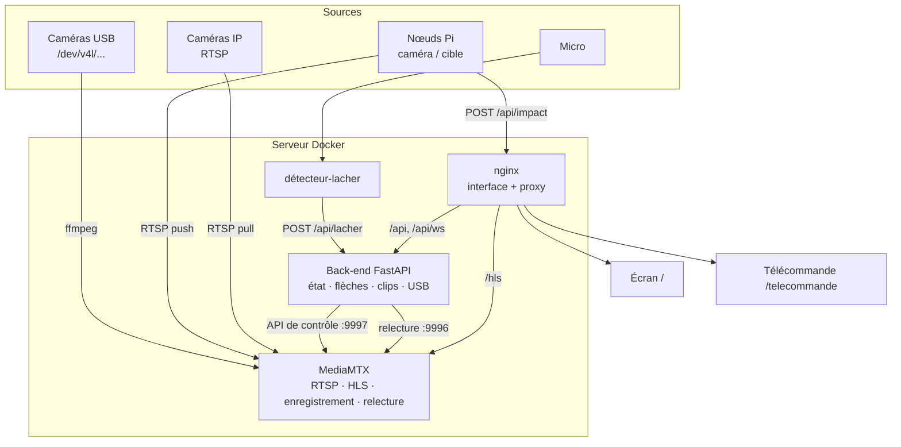
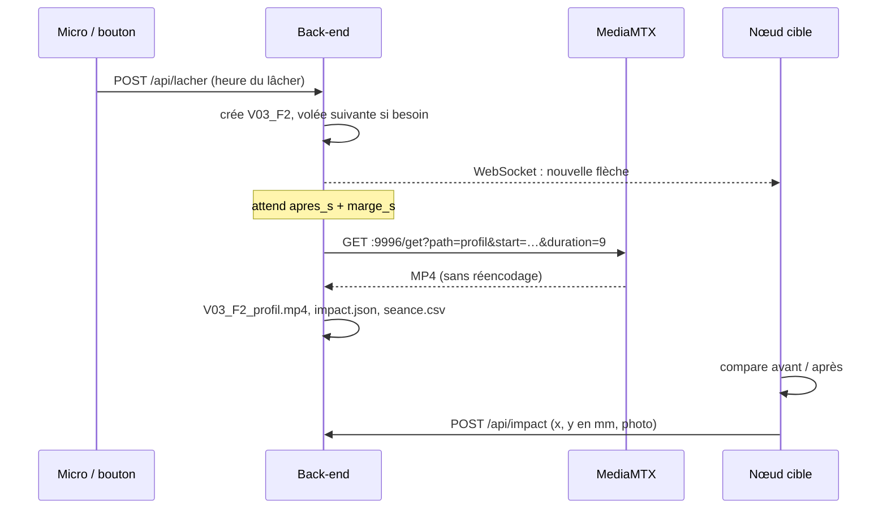

# Architecture

## Vue d'ensemble



| Composant | Rôle |
|---|---|
| **MediaMTX** | Reçoit tous les flux, les sert en HLS (avec 40 s d'historique), les enregistre en continu et découpe des extraits à la demande. Aucun transcodage. |
| **Back-end** (Python, FastAPI) | Garde l'état partagé (disposition, retard, flèches, rejeu), le diffuse par WebSocket, crée les chemins MediaMTX, extrait les clips, gère l'export USB. |
| **Interface** (React, nginx) | Deux pages : l'écran (affichage seul) et la télécommande. nginx sert aussi les clips et relaie HLS et API. |
| **Détecteur de lâcher** | Conteneur optionnel qui écoute un micro USB et signale chaque lâcher. |
| **Nœuds Raspberry Pi** | Hors Docker (systemd), pour rester légers sur un Pi Zero 2 W. Ils encodent avec l'encodeur H.264 matériel du Pi et poussent leur flux vers le serveur. |

## Le retard de 10 secondes

MediaMTX garde en permanence une fenêtre HLS de 40 segments d'une seconde (`hlsAlwaysRemux`), même sans spectateur : à l'ouverture, l'écran dispose déjà de l'historique.

Chaque vue est un lecteur hls.js. Une boucle de recalage, chaque seconde :

1. lit l'heure de l'image affichée (balise `EXT-X-PROGRAM-DATE-TIME` posée par MediaMTX) ;
2. la compare à « heure du serveur − retard » ;
3. avance ou recule la lecture si l'écart dépasse 0,4 s.

Toutes les vues visent la même heure absolue, elles restent donc synchronisées entre elles. L'heure du serveur est mesurée par la page via le WebSocket (`ping`/`pong`), car une tablette sans internet a souvent une horloge décalée. Si un flux ne fournit pas d'heure, la vue se cale sur « bord du direct − retard ».

Pour que les segments durent bien une seconde, **chaque source doit émettre une image clé par seconde** : `-g <fps>` pour ffmpeg, `iperiod=fps` pour les nœuds Pi. C'est réglé automatiquement.

## Une flèche, des clips



Le serveur de relecture de MediaMTX recolle les morceaux d'enregistrement et renvoie un MP4 standard : la découpe est quasi instantanée, même sur un Pi 5 sans encodeur matériel. L'enregistrement continu est purgé après 3 h (`recordDeleteAfter`), les clips extraits restent dans le volume `donnees`.

Organisation sur disque (et sur la clé USB) :

```
seances/2026-10-23_18h41/
  seance.csv                    # une ligne par flèche (séparateur ;)
  volee01/
    fleche1/
      V01_F1_profil.mp4
      V01_F1_face.mp4
      V01_F1_arriere.mp4
      V01_F1_cible.mp4
      V01_F1_impact.jpg         # photo annotée du nœud cible
      impact.json               # heure, score, position, latéralité
```

## État partagé

Le back-end est la seule source de vérité. Toute action (télécommande, micro, nœud cible) modifie l'état, qui est sauvegardé dans `/data/etat.json` puis diffusé en entier à tous les clients WebSocket. Un écran qui se reconnecte retrouve donc immédiatement la bonne disposition. Plusieurs écrans et plusieurs télécommandes peuvent être connectés en même temps.

## Choix techniques

| Choix | Raison |
|---|---|
| HLS plutôt que WebRTC | Le retard est voulu : HLS permet de lire dans le passé avec un simple lecteur web, sur tous les navigateurs. |
| Pas de transcodage au serveur | Le Pi 5 n'a pas d'encodeur H.264 matériel. Les caméras USB en MJPEG sont encodées une seule fois (libx264 ultrafast, ou VAAPI sur Intel). |
| Nœuds qui poussent leur flux | Le serveur (10.42.0.1) n'a besoin de connaître l'adresse d'aucun nœud. |
| Nœuds hors Docker | Un Pi Zero 2 W n'a que 512 Mo de RAM ; picamera2 s'installe directement par apt. |
| Navigateur comme client | Rien à installer sur la tablette ou la TV ; mêmes pages partout. |
| Configuration en YAML | Ajouter une vue = ajouter quelques lignes, sans toucher au code. |

## Ports

| Port | Service | Exposé |
|---|---|---|
| 80 | Interface, API, HLS, clips | oui |
| 8554 | RTSP (publication des nœuds) | oui |
| 8888 | HLS MediaMTX | interne (via `/hls/`) |
| 9996 | Relecture MediaMTX | interne |
| 9997 | API de contrôle MediaMTX | interne |
| 8000 | Back-end | interne (via `/api/`) |

Le serveur n'a **aucune authentification** : il est prévu pour un réseau local fermé. Ne l'exposez pas sur internet en l'état.
